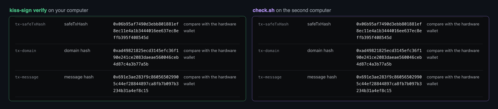

<h1 align="center">kiss-sign-check</h1>

<p align="center"><b><i>A second look at a Safe transaction, on a computer with no AI.</i></b></p>

> [!WARNING]
> kiss-sign-check is still under development and is not ready for real use. Do not rely on it to sign transactions yet.

Remember [decoding a Safe transaction by hand](https://github.com/ipromise2324/kiss-sign#why), with safe-tx-hashes and `cast`? `check.sh` does that for you, in one command, on a second, clean computer that has no AI and no kiss-sign. Then you compare its page with kiss-sign's, row by row. If your work computer, its AI or kiss-sign itself was wrong or tampered with, the two pages differ.

<picture>
  <source media="(prefers-color-scheme: dark)" srcset="docs/readme/overview-dark.png">
  
</picture>

## Contents

- [Set up](#set-up)
- [Use](#use)
- [What it does not do](#what-it-does-not-do)
- [More](#more)
- [Contributing](#contributing)
- [Disclaimer](#disclaimer)
- [Donate](#donate)
- [License](#license)

## Set up

On the clean computer, install [Foundry](https://getfoundry.sh) for `cast`, and `jq` 1.7 or later. macOS's own `curl` and Bash are enough. Then:

```sh
git clone https://github.com/ipromise2324/kiss-sign-check.git && cd kiss-sign-check
cp config.example config  # set your SAFE, its SAFE_VERSION and the LANGUAGE you gave kiss-sign
```

## Use

When kiss-sign `verify` prints `MATCH`, type on the clean computer the command it prints, such as:

```sh
./check.sh 1566
```

Open the page it writes and check three things.

**1. The hashes.** They must be the same on both pages and on your hardware wallet's screen. If not, do not sign.



**2. The comparison list.** Every call, row by row, down to the calls inside a batch, must be the same as on kiss-sign's page. Only the name column on the right may differ: kiss-sign names addresses from its registry, `check.sh` names only your Safe, the official MultiSends and the zero address. If any other row differs, stop.


**3. The warnings and the calls.** Read every warning, and read each call's `to`, amount and recipient against what you meant to do. Equal rows prove only that both computers decoded the same bytes the same way.

### Hints

Some `bytes` hold data in a fixed shape that no ABI describes, such as a CoW order's UID. kiss-sign's template knows the shape, so after `MATCH` it adds `--hints` to the command:

```sh
./check.sh 264 --hints 'v1 C1-a1=packed(bytes32,address,uint32)'
```

This says: argument 1 of call `C1` is a `bytes32`, an `address` and a `uint32` packed together. `check.sh` splits the 56 bytes that way, checks the parts join back into exactly those bytes, and shows them under a warning:

```
function:  setPreSignature(bytes,bool)
  argument 1:  0xc45125ce…6ae5533c
  C1-a1 as packed bytes32 address uint32 (--hints):
  !! Warning: call #1's 56 bytes at C1-a1 (0xc45125ce…) are shown as --hints reads them …
    part 1:  0xc45125ce75112738d7cde40eef1321f070e792066f9211fd0c4eb1616c309b64
    part 2:  0xb18D844f3578EaD22791B5c67F7B6aF93266804E
    part 3:  1793413948
```

Here part 2 is the order's owner, your Safe, and part 3 its expiry time. A hint only helps you read: it never changes a row of the comparison list, so a wrong hint cannot make the two pages match. The format and every rule are in [docs/hints.md](docs/hints.md).

## What it does not do

- **It does not judge.** It does not know whether a contract is the protocol's real one, or whether the transaction is what you meant. kiss-sign does that, against your card.
- **It does not read the chain or simulate.** It sees the transaction, not its effects.
- **It does not prove an ABI.** Sourcify's ABI only helps you read; if it is wrong, the comparison list differs from kiss-sign's.

## More

- [docs/details.md](docs/details.md): the settings, what it fetches, every check and warning, and the tests.
- [docs/hints.md](docs/hints.md): the `--hints` kiss-sign adds for bytes no ABI describes.
- [docs/checklist.md](docs/checklist.md): the comparison list's row format.

## Contributing

Open an issue or a pull request. Keep `check.sh` short enough to read in one sitting, and keep it to `cast`, `curl` and `jq`. A change to the comparison list's format must change kiss-sign in step; see [docs/checklist.md](docs/checklist.md).

Report security problems as an issue too.

## Disclaimer

`check.sh` is provided as is, without warranty of any kind. It can be wrong: a bug, a compromised Safe Transaction Service or a compromised second computer can make it show rows that match a transaction you did not mean. Matching rows say only that two programs decoded the same bytes the same way. They do not say that a protocol, a contract or a transaction is safe, and nothing here is financial, legal or security advice.

You alone are responsible for every transaction you sign. The authors and contributors are not liable for any loss, however it arises, including through the use of kiss-sign or kiss-sign-check.

## Donate

If kiss-sign-check is useful to you, you can support it here, the same address as kiss-sign's.

**Ethereum mainnet only:**

```
0x085e5A79318931FA87050B8B677f2dc0Df303D67
```

Copy the address from this page on GitHub, and compare it in full before you send.

## License

[MIT](LICENSE). Anyone may use, copy, change, publish and sell kiss-sign-check, provided the license notice stays with it.
