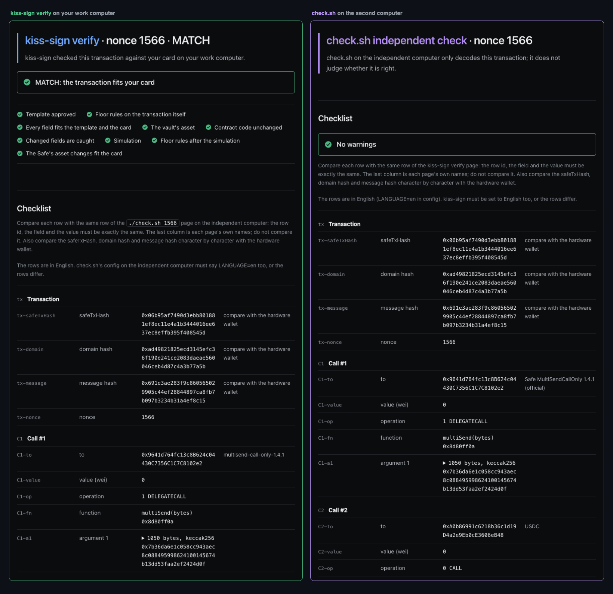
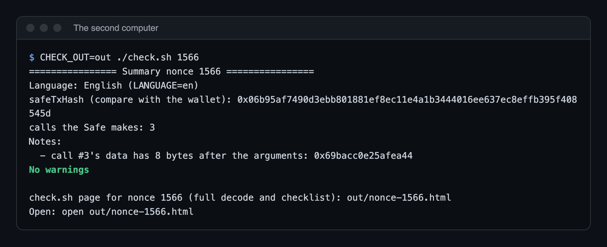

<h1 align="center">kiss-sign-check</h1>

<p align="center"><b><i>A second look at a Safe transaction, on a computer with no AI.</i></b></p>

[kiss-sign](https://github.com/ipromise2324/kiss-sign) checks a Safe transaction against what you said you wanted. But kiss-sign runs on your work computer, next to your AI, and that computer, the AI or kiss-sign itself can be wrong or tampered with. kiss-sign's [hardened tier](https://github.com/ipromise2324/kiss-sign/blob/main/docs/design.md#two-tiers) adds a second computer that has no AI and no kiss-sign, and `check.sh` is what runs there: one Bash script that decodes the same transaction on its own. A change to kiss-sign cannot change what this computer decodes, and you read that decode yourself before you sign.



## Contents

- [Why](#why)
- [How it works](#how-it-works)
- [What it checks](#what-it-checks)
- [What it does not do](#what-it-does-not-do)
- [Tests](#tests)
- [Contributing](#contributing)
- [Disclaimer](#disclaimer)
- [Donate](#donate)
- [License](#license)

## Why

- **One computer is one point of failure.** If malware or a prompt-injected AI controls your work computer, it can change what kiss-sign shows you. `check.sh` shares neither the computer, the code nor the address list with it. Both read the transaction from the same Safe Transaction Service, so the hashes on your hardware wallet are what tie them to what you sign.
- **The Safe Transaction Service's decode is not used.** The service and the Safe web app both show a decoded view of the transaction. `check.sh` ignores it. It computes the hash your hardware wallet signs and decodes every call itself, from the raw `to`, `value`, `data` and `operation` fields.
- **You can read all of it.** It is about 1,000 lines of Bash that use Foundry's `cast`, `curl`, `jq` and standard Unix tools, and nothing else. You read it once, in one sitting, and pin the commit you read.

## How it works

### Set up the second computer, once

Install Foundry for `cast`, and `jq` 1.7 or later from your package manager (check with `jq --version`):

```sh
curl -L https://foundry.paradigm.xyz | bash
foundryup
```

macOS ships `curl` and Bash 3.2, which is enough. Then:

```sh
git clone https://github.com/ipromise2324/kiss-sign-check.git
cd kiss-sign-check
less check.sh known-functions.txt known-layouts.txt  # read all three in full, once
git rev-parse HEAD                 # write down the commit you read
git status --short                 # before each use: git rev-parse HEAD gives the commit you wrote down, and this prints nothing
cp config.example config  # set SAFE, SAFE_VERSION (as the Safe web app shows it) and LANGUAGE
```

Set `LANGUAGE` to the language your kiss-sign uses, the one its `init` recorded: `en` (the default, also when the line is missing) or `zh-TW`. All of `check.sh`'s output follows it, the comparison list included, so with two different languages the rows differ and you stop. Any other value is refused.

A wrong `SAFE_VERSION` can give a hash that does not match your wallet, and a matching hash does not prove the version is right: versions 1.3.0 to 1.5.0 hash the same way, as do 1.1.0 to 1.2.0.

Then write `known-addresses.txt` by hand, one `0x<address> <name>` per line, copying each address from the protocol's official documentation; `known-addresses.example.txt` shows the format. Never copy it from the work computer: the point is that this list does not come from there. The official Safe MultiSend addresses are built in. `CHECK_CONFIG`, `CHECK_KNOWN` and `CHECK_LAYOUTS` can name another config, address list and layout list, and the page names the ones it used. `config`, `known-addresses.txt` and `out/` are ignored by git and stay on this computer.

### At each signing

After you propose the transaction and kiss-sign `verify` prints `MATCH` on your work computer, run on the second computer:

```sh
./check.sh 1566
```

It fetches the transactions at that nonce from `api.safe.global`, mainnet only and with no API key. That is its only network request. `./check.sh --file <tx.json>` reads the same JSON from a file instead. The terminal prints a summary (here run with `CHECK_OUT=out`, so the page path is short):



This is a real run, on another Safe's Morpho vault deposit: an `approve` and a Bundler3 `multicall`, batched through MultiSend. Open the page and check four things:

1. **The hashes.** Compare them with your hardware wallet's screen, character by character: the domain hash and message hash, or the safeTxHash if that is what your wallet shows. If they differ, do not sign.
2. **The comparison list** (Checklist, or 比對清單 in Traditional Chinese). Compare it with the one on kiss-sign `verify`'s page, row by row, as in the picture above. Every row must be equal, except the name column on the right, where each side names addresses from its own list. If any other row differs, stop.
3. **The warnings.** Read every `!! Warning` line (`!! 警告` in Traditional Chinese). A warning means look closer, not necessarily stop. A note, such as the 8 bytes above, is a fact of the decode that `check.sh` does not judge.
4. **The calls themselves.** Read every call's `to`, amount and recipient against what you meant to do. Equal rows prove only that both computers decoded the same bytes the same way: a work computer that proposed the wrong transaction can still show its true decode.

The page also holds the full decode, with every call and every address named from your list:


If several transactions share the nonce, the summary and the page show each one with its hash. Sign only the one whose hashes your wallet shows.

The page and the terminal are in the language `config` sets, as kiss-sign's page is in the one its `init` recorded; set both the same, and every row but the name column compares byte for byte. The page runs no script and loads nothing from outside. Its accent colour differs from kiss-sign's, so the two pages are not mistaken for each other side by side. The row format is in [docs/checklist.md](docs/checklist.md).

### Teach it a new function

`check.sh` decodes only the functions in [`known-functions.txt`](known-functions.txt), one signature per line, and computes each selector with `cast sig`. It never guesses a function or looks one up online. Today the list covers ERC-20, ERC-4626 vaults, Safe MultiSend, Morpho Bundler3 and its adapters, Uniswap Permit2's `approve` and the Universal Router's `execute`, CoW's `setPreSignature`, Morpho Blue's `setAuthorization`, Morpho Vault V2's admin functions (`multicall`, `submit`, `revoke`, the cap changes, `allocate` and `deallocate`), Morpho's Universal Rewards Distributor's `claim`, Merkl and Fluid claims, CCTP's `receiveMessage`, and the Safe's own admin functions. A decoder is matched by the full signature, so Vault V2's `multicall(bytes[])` and Bundler3's `multicall` are told apart.

Each kiss-sign template's calls decode, so their rows match `verify`'s.

### Teach it a data layout

Some `bytes` arguments hold no call but data in a fixed shape: a Morpho Vault V2 cap id, a CoW order UID, the inputs of a Uniswap Universal Router `execute`. [`known-layouts.txt`](known-layouts.txt), also written by hand from each protocol's source, each group of lines citing its source, says how to read them: as `abi.encode` of some types, as `abi.encodePacked` of fixed-size parts, or as a table of command bytes, at most two levels deep. The full decode then shows the parts, with every address named from your list, and that argument's warning is dropped, but only when the parts encode back to exactly the original bytes. Otherwise the warning stays, with a second one saying why. Decoded parts are never comparison-list rows, so the list is the same with or without them.

The shipped file reads Vault V2's cap ids and a market adapter's `allocate` and `deallocate` data, CoW's order UID, and the Universal Router's `PERMIT2_PERMIT` and `V4_SWAP` commands with the v4 swap actions and `SETTLE`, `SETTLE_ALL`, `TAKE`, `TAKE_ALL` and `TAKE_PORTION`. Every other router command or v4 action still warns, as does a bytes part such as a permit's 65-byte signature. A clean decode is not a judgment: a cap id that decodes may name a market you did not mean, and a swap's amounts are only shown. The format, its checks and the full coverage list are in [docs/known-layouts.md](docs/known-layouts.md).

## What it checks

- **The hash, computed locally.** The safeTxHash comes from the same `to`, `value`, `data`, `operation` and gas fields the decode prints. The service's own hash is used only to warn when it differs.
- **Every call.** Each call inside a MultiSend, each call of a Bundler3 `multicall` with its target and value, the bundle Morpho calls back with from `morphoSupplyCollateral`, and each known call inside any other `bytes` argument. A MultiSend is split into the Safe's calls only when the Safe itself DELEGATECALLs an official MultiSend, and the list must split exactly.
- **The decode is exact.** The decoded arguments are encoded again and compared with the data. Bytes after the arguments are a note; any other difference is a warning.
- **Every address is named, or flagged.** Names come only from your `known-addresses.txt`, the built-in MultiSend list, the Safe in your `config` and the zero address.
- **Warnings for what usually means trouble:**
  - non-zero `safeTxGas`, `baseGas`, `gasPrice`, `gasToken` or `refundReceiver`;
  - a DELEGATECALL other than the Safe's own call into an official MultiSend, or a plain CALL into an official MultiSend;
  - a zero `to` inside a MultiSend;
  - an unknown function or address, or a `bytes` argument or part it cannot decode, or that fits no layout it has;
  - ETH sent along with a call that has data, from the Safe or a MultiSend (a Bundler3 call's value is shown, not warned on);
  - a Safe admin function anywhere, such as adding an owner;
  - several transactions at one nonce;
  - a service hash that differs or is malformed.
- **Text from outside cannot run or hide on the page.** Every value reaches the page through `jq`'s `@html`, and control, bidi and zero-width characters become U+FFFD. The terminal has its control characters removed (C0 except tab and newline, and DEL). At start it checks that `cast` and `jq` behave as it expects, and refuses to run otherwise.

## What it does not do

- **It does not judge.** It does not know whether a contract is the protocol's real one, or whether the transaction is what you meant. kiss-sign does that, against your card. `check.sh` only shows what the transaction is, so read its calls against what you meant to do.
- **It does not read the chain or simulate.** It sees the transaction, not its effects.
- **Bytes that are neither a known call nor a known layout stay opaque.** A CCTP message, or a Uniswap router command `known-layouts.txt` does not cover, is shown raw with a warning. Addresses packed inside such bytes are not named. A value of exactly 20 or 32 bytes, or under 4 bytes, is never decoded and gets no warning, since it reads like an address, a `bytes32` or a short field. The exceptions: each call of `multicall(bytes[])`, `submit(bytes)` and `revoke(bytes)`, and each element under a `commands` layout, is decoded or warned about whatever its length, and a `known-layouts.txt` line reads a value of any length.
- **Amounts are raw integers**, in the token's base units, as kiss-sign's comparison list prints them.
- **Mainnet only**, and Safe versions 1.1.0, 1.1.1, 1.2.0, 1.3.0, 1.4.0, 1.4.1 and 1.5.0.

## Tests

```sh
/bin/bash test/run.sh
```

[`test/fixtures/`](test/fixtures/) holds real transactions of other Safes, recorded by kiss-sign, and crafted cases: hostile ones (`hostile-*`) and the two Vault V2 cap ids no recorded transaction holds. Each real case must reproduce its recorded on-chain safeTxHash. The tests read both the terminal and the page, compare the comparison lists of seven transactions, in each language, with [`test/expected/en/`](test/expected/en/) and [`test/expected/zh-TW/`](test/expected/zh-TW/) (a Bundler3 deposit, an ETH transfer, a Merkl claim, a CoW order, a Uniswap swap with its approvals, a Vault V2 cap submission and a reallocation), which kiss-sign's own tests also pin, compare the full decode of five cases `known-layouts.txt` reads, check that the comparison list is the same without the layout file, that a layout that does not fit keeps its warning and says why, and that a malformed or wrong layout line is refused, and check that hostile text in the service's fields is never shown, and that the same text as an address-list name is shown escaped, with its bidi and control characters replaced. `test/known-addresses.txt` is for the tests only; do not sign with it.

The official MultiSend addresses in `check.sh` come from [safe-global/safe-deployments](https://github.com/safe-global/safe-deployments) at commit `ca9cb0d2d5f5175fc8e41d579f356748d2bc1c62`.

## Contributing

Open an issue or a pull request. Keep `check.sh` short enough to read in one sitting, and keep it to `cast`, `curl` and `jq`. A change to the comparison list's format must change kiss-sign in step; see [docs/checklist.md](docs/checklist.md).

Report security problems as an issue too.

## Disclaimer

`check.sh` is provided as is, without warranty of any kind. It can be wrong: a bug, a wrong address list, a compromised Safe Transaction Service or a compromised second computer can make it show rows that match a transaction you did not mean. Matching rows say only that two programs decoded the same bytes the same way. They do not say that a protocol, a contract or a transaction is safe, and nothing here is financial, legal or security advice.

You alone are responsible for every transaction you sign. The authors and contributors are not liable for any loss, however it arises, including through the use of kiss-sign or kiss-sign-check.

## Donate

If kiss-sign-check is useful to you, you can support it with ETH on Ethereum mainnet:

```
TODO: donation address
```

Copy the address from this page on GitHub, and compare it in full before you send.

## License

[MIT](LICENSE). Anyone may use, copy, change, publish and sell kiss-sign-check, provided the license notice stays with it.
